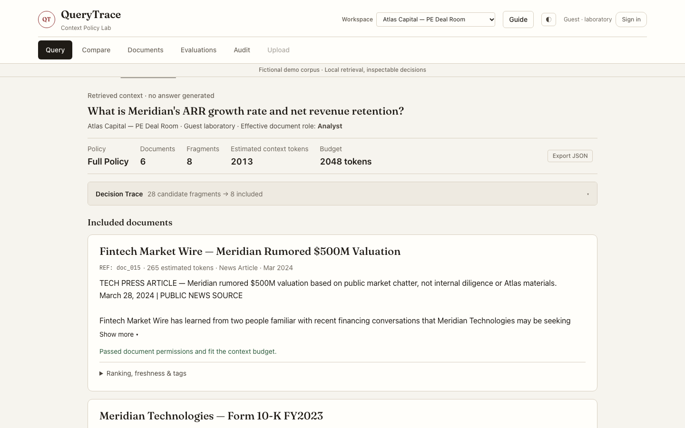

# QueryTrace

See which document fragments enter a query's context—and why others are blocked, penalized or excluded.

[](https://github.com/Julian0444/QueryTrace/actions/workflows/ci.yml)
[](LICENSE)

QueryTrace combines hybrid search, document permissions, freshness and a token budget with an inspectable decision trace. **Query retrieves context. Ask optionally sends that context to a language model.** They are separate operations.

The two included workspaces and their public accounts are fictional demonstrations. Guest laboratory mode deliberately allows policy experiments, including unsafe baselines; it is not a protected production deployment.

[](docs/evidence/ui-polish/video/querytrace-demo.mp4)

**[Watch the recorded walkthrough](docs/evidence/ui-polish/video/querytrace-demo.mp4)** · **[Watch on YouTube](https://www.youtube.com/watch?v=N0zUpEQrKhE)** · [Transcript and local player](docs/demo-guide.md#recorded-walkthrough) · [Before / after](docs/evidence/ui-polish/README.md)

The video uses real local retrieval and public demo data, with English captions and no model calls. The cover links to an MP4 file; it does not claim an embedded GitHub player. To try the application, start it locally below.

## Run locally

Python 3.11 is the verified local runtime. CI also checks Python 3.9 compatibility.

```bash
python3.11 -m venv .venv
source .venv/bin/activate
pip install -r requirements-dev.txt
python -m uvicorn src.main:app --host 127.0.0.1 --port 8000
```

Open [localhost:8000/app/](http://localhost:8000/app/) or [127.0.0.1:8000/app/](http://127.0.0.1:8000/app/). The frontend and API share the same origin. Cookies belong to the hostname used: switching between these two hostnames starts a separate browser session. Login, reload and logout work within either hostname.

The first retrieval may download the local embedding model and tokenizer. Later retrieval does not call an answer provider. No JavaScript build step is needed to run the application.

Leave `ANTHROPIC_API_KEY` unset for a free walkthrough: Query, Compare, Documents, Evaluations, the tutorial and authorized local Upload/Audit work without it. Ask remains visible with an explanation. Setting that key enables live model requests, which may incur charges; see [configuration](docs/configuration.md).

## Explore

1. **Query:** ask “What is Meridian's ARR growth rate and net revenue retention?” Inspect the retrieved text, document/fragment counts and token budget.
2. **Decision Trace:** open the selection record, including permission blocks, exclusions and partially included documents. Empty results keep their explanation and trace.
3. **Compare:** run the same query and role through three policies. Headers and metrics align, and each column states its selection limits.
4. **Documents and Evaluations:** inspect authorized source text and classifications; review benchmark completion, metric definitions and per-query results.
5. **Audit, Upload and Ask:** inspect scoped execution records, ingest supported files with an authorized administrator, or optionally generate an answer from the context actually sent.

Start the six-step guide from the welcome screen, or reopen it with **Guide**. It explains the active workspace, identities, a first query, comparison, the decision trace and optional answers. Loading a scenario requires an explicit click; the guide never uploads or calls a model automatically.

## Demo accounts and modes

| Workspace | Public account / password | Document role | Administrative permission |
|---|---|---|---|
| PE deal room | `julia` / `demo-analyst` | analyst | No |
| PE deal room | `victoria` / `demo-vp` | vp | No |
| PE deal room | `patricia` / `demo-admin` | partner | Yes |
| SaaS knowledge base | `sofia` / `demo-employee` | employee | No |
| SaaS knowledge base | `marcos` / `demo-manager` | manager | No |
| SaaS knowledge base | `alex` / `demo-admin` | exec | Yes |

The runtime account cards and tutorial read the workspace configuration. Authenticated users use their server-enforced document role and full policy. Administrators can simulate lower roles, and the interface distinguishes identity from effective role. Guest laboratory mode can explore all demo roles. Switching workspace clears the session and results.

Without an answer-provider key, retrieval, comparison, evaluation, Guide and authorized local Upload/Audit still work. Ask remains visible but disabled with an explanation. The tutorial adapts to workspace configuration and never uploads or calls a model automatically.

## Reading the results

Trace counts distinguish documents from fragments and disclose partial inclusion. Relative ranking is **not confidence**. Full policy combines permissions, freshness, an evidence gate and a default 2,048-token context budget. Top-k is an unfiltered k-fragment baseline; Whole corpus is a separate all-fragment baseline.

Compare shows each policy's actual selection rules. Token savings depend on the baseline and corpus: the verified fixtures use fewer tokens in PE but more in SaaS versus top-8. [Definitions, measurements and reproducible commands](docs/evaluation.md).

## Upload and bring your own corpus

Administrators can upload supported PDF, text, Markdown and DOCX files when ingestion is enabled. DOCX paragraphs, tables and headers/footers are preserved; unsupported rich content is rejected explicitly. Index publication is coordinated and recoverable. [Upload behavior and limits](docs/uploads.md).

```bash
python -m src.workspace create my-kb --from-dir /absolute/path/to/documents --name "My knowledge base"
python -m src.workspace list
```

A custom corpus works without benchmark queries, scenarios or demo users. Evaluations reports “unavailable” instead of borrowing another workspace's data. Review guest access before adding private content. [Workspace configuration](docs/configuration.md).

## Validate

```bash
python -m pytest tests/ -q
ruff check src/ tests/
python -m src.evaluator --workspace pe-deal --compare
python -m src.evaluator --workspace saas-internal --compare
npm ci
npx playwright install chromium
QUERYTRACE_TEST_PYTHON="$PWD/.venv/bin/python" npm run test:e2e
```

Browser tests use a temporary corpus and a deterministic simulated answer provider. They do not send paid model requests. Incomplete or failed evaluator runs exit nonzero; a complete run with a full-policy permission violation also fails. CI executes tests before the evaluator, so the former evaluator defect did not imply all CI checks passed.

## Scope and evidence

This is a single-service demonstration: FastAPI, Pydantic, FAISS/BM25, local MiniLM embeddings, tiktoken, optional Anthropic answers, and vanilla HTML/CSS/JavaScript. Signed-cookie demo authentication, public credentials, in-memory audit/jobs/caches, local file storage, and mechanical citation membership checks have explicit limits. A valid citation does **not** establish semantic support for a claim.

- [Architecture and contracts](docs/architecture.md)
- [Configuration and local sessions](docs/configuration.md)
- [Presentation walkthrough](docs/demo-guide.md)
- [Evaluation definitions and measured results](docs/evaluation.md)
- [Uploads, extraction and limits](docs/uploads.md)
- [UI polish, comparable screenshots and local validation](docs/evidence/ui-polish/README.md)
- [Remediation matrix and verification evidence](docs/remediation-plan.md)

The Render blueprint follows `main`, which already contains the former deployment branch's merge. Changes on the review branch are not deployed. The base revision was verified in Docker on Linux ARM64: 505 backend tests, real browser flows, uploads/restarts and offline benchmarks. This UI revision is verified locally; it has not been rebuilt in Docker. See the [Docker run instructions and evidence](docs/docker-validation.md). Real answer-provider integration and external deployment remain unverified.
