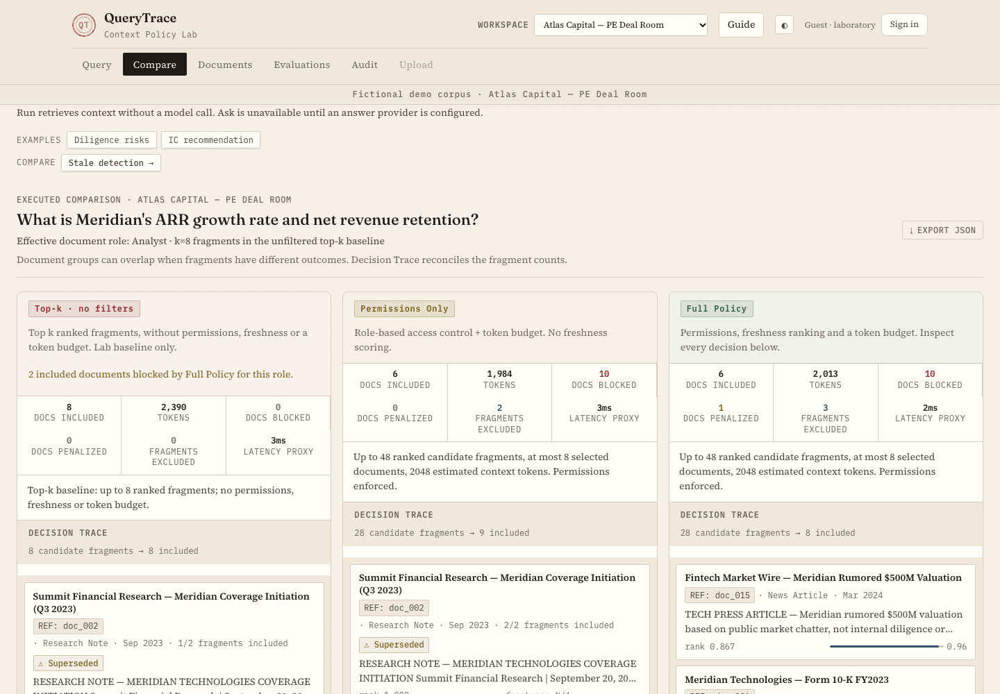

# QueryTrace

See which document fragments enter a query's context—and why others are blocked, penalized or excluded.

[](https://github.com/Julian0444/QueryTrace/actions/workflows/ci.yml)
[](LICENSE)

QueryTrace combines hybrid search, document permissions, freshness and a token budget with an inspectable decision trace. **Query retrieves context. Ask optionally sends that context to a language model.** They are separate operations.

The two included workspaces and their public accounts are fictional demonstrations. Guest laboratory mode deliberately allows policy experiments, including unsafe baselines; it is not a protected production deployment.



## Run locally

Python 3.11 is the verified local runtime. CI also checks Python 3.9 compatibility.

```bash
python3.11 -m venv .venv
source .venv/bin/activate
pip install -r requirements-dev.txt
python -m uvicorn src.main:app --host 127.0.0.1 --port 8000
```

Open [localhost:8000/app/](http://localhost:8000/app/) or [127.0.0.1:8000/app/](http://127.0.0.1:8000/app/). The frontend and API share the same origin. Cookies belong to the hostname used: switching between these two hostnames starts a separate browser session. Login, reload and logout work within either hostname.

The first retrieval may download the local embedding model and tokenizer. Later retrieval does not call an answer provider. No JavaScript build step is needed to run the application.

Leave `ANTHROPIC_API_KEY` unset for a free walkthrough: Query, Compare, Documents, Evaluations, the tutorial and authorized local Upload/Audit work without it. Ask remains visible with an explanation. Setting that key enables live model requests, which may incur charges; see [configuration](docs/configuration.md).

## Explore

Start the six-step guide from the welcome screen, or reopen it with **Guide**. It explains the active workspace, identities, a first query, comparison, the decision trace and optional answers. Loading a scenario requires an explicit click; the guide never uploads or calls a model automatically.

| Workspace | Public account / password | Document role | Administrative permission |
|---|---|---|---|
| PE deal room | `julia` / `demo-analyst` | analyst | No |
| PE deal room | `victoria` / `demo-vp` | vp | No |
| PE deal room | `patricia` / `demo-admin` | partner | Yes |
| SaaS knowledge base | `sofia` / `demo-employee` | employee | No |
| SaaS knowledge base | `marcos` / `demo-manager` | manager | No |
| SaaS knowledge base | `alex` / `demo-admin` | exec | Yes |

The runtime account cards and tutorial read the workspace configuration. Authenticated users use their server-enforced document role and full policy. Administrators can simulate lower roles, and the interface distinguishes identity from effective role. Guest laboratory mode can explore all demo roles. Switching workspace clears the session and results.

Use **Documents** to inspect classifications and authorized source text. Use **Query** for context, **Compare** for policy differences, and **Evaluations** for benchmark execution coverage. Trace counts distinguish documents from fragments, and show partial inclusion. Audit is scoped to the active workspace and includes the user and execution parameters.

## Reproducible policy comparisons

| Policy | Retrieval | Permission filter | Freshness | Final cap |
|---|---|---|---|---|
| `naive_top_k` | Exactly up to k ranked fragments | Off | Off | k fragments; no token cap |
| `whole_corpus` | Every fragment | Off | Off | None; k unused |
| `permission_aware` | Up to 6 × k ranked fragments | On | Off | k unique documents, token budget |
| `full_policy` | Up to 6 × k ranked fragments | On | On | k unique documents, token budget |

The filtered policies also abstain when permitted candidates lack sufficient semantic evidence. Relative ranking scores are not probabilities. Full policy defaults to a 2,048-token local estimate. See [architecture](docs/architecture.md) for the evidence gate and accounting contract.

Measured on all 12 configured queries per workspace, k=8, precision k=5:

| Workspace / policy | Queries with unauthorized context | Mean selected tokens | Recall |
|---|---:|---:|---:|
| PE / top-8 fragments | 7/12 (58.33%) | 2,265.4 | .875 |
| PE / whole corpus | 8/12 (66.67%) | 7,151.0 | 1.000 |
| PE / full policy | 0/12 | 2,016.8 | 1.000 |
| SaaS / top-8 fragments | 9/12 (75.00%) | 1,939.4 | 1.000 |
| SaaS / whole corpus | 9/12 (75.00%) | 6,592.0 | 1.000 |
| SaaS / full policy | 0/12 | 2,021.6 | 1.000 |

Full policy uses **10.98% fewer tokens in PE and 4.24% more in SaaS than top-8**. Against the whole corpus it uses 71.80% and 69.33% fewer, respectively. These are fixture measurements, not general performance promises. The earlier “50% / 58%” permission metrics used incomplete forbidden-document lists and an all-corpus baseline incorrectly called top-k. [Evaluation methodology and before/after evidence](docs/evaluation.md).

## Upload and bring your own corpus

Administrators can upload supported PDF, text, Markdown and DOCX files when ingestion is enabled. DOCX paragraphs, tables and headers/footers are preserved; unsupported rich content is rejected explicitly. Index publication is coordinated and recoverable. [Upload behavior and limits](docs/uploads.md).

```bash
python -m src.workspace create my-kb --from-dir /absolute/path/to/documents --name "My knowledge base"
python -m src.workspace list
```

A custom corpus works without benchmark queries, scenarios or demo users. Evaluations reports “unavailable” instead of borrowing another workspace's data. Review guest access before adding private content. [Workspace configuration](docs/configuration.md).

## Validate

```bash
python -m pytest tests/ -q
ruff check src/ tests/
python -m src.evaluator --workspace pe-deal --compare
python -m src.evaluator --workspace saas-internal --compare
npm ci
npx playwright install chromium
QUERYTRACE_TEST_PYTHON="$PWD/.venv/bin/python" npm run test:e2e
```

Browser tests use a temporary corpus and a deterministic simulated answer provider. They do not send paid model requests. Incomplete or failed evaluator runs exit nonzero; a complete run with a full-policy permission violation also fails. CI executes tests before the evaluator, so the former evaluator defect did not imply all CI checks passed.

## Scope and evidence

This is a single-service demonstration: FastAPI, Pydantic, FAISS/BM25, local MiniLM embeddings, tiktoken, optional Anthropic answers, and vanilla HTML/CSS/JavaScript. Signed-cookie demo authentication, public credentials, in-memory audit/jobs/caches, local file storage, and mechanical citation membership checks have explicit limits. A valid citation does **not** establish semantic support for a claim.

- [Architecture and contracts](docs/architecture.md)
- [Configuration and local sessions](docs/configuration.md)
- [Presentation walkthrough](docs/demo-guide.md)
- [Evaluation definitions and measured results](docs/evaluation.md)
- [Remediation matrix and verification evidence](docs/remediation-plan.md)

The Render blueprint follows `main`, which already contains the former deployment branch's merge. Changes on the review branch are not deployed. Docker build and execution are now verified on Linux ARM64: 505 backend tests, real browser flows, uploads/restarts and offline benchmarks. See the [Docker run instructions and evidence](docs/docker-validation.md). Real answer-provider integration and external deployment remain unverified.
