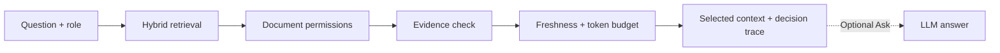

# QueryTrace

**An auditable RAG gateway that checks which document fragments an LLM may use—and shows why each one was selected or rejected.**

Similarity search alone can retrieve a confidential document, an obsolete version, or more text than a model's context budget allows. QueryTrace adds three checks before that context reaches the model: **Can this user see it? Is it current? Does it fit?**

[](https://github.com/Julian0444/QueryTrace/actions/workflows/ci.yml)
[](LICENSE)

In the bundled fictional benchmarks, queries returning unauthorized documents fell from **7/12 to 0/12** in the PE workspace and **9/12 to 0/12** in SaaS when comparing unfiltered Top-8 with Full Policy. These are local fixture results, not a production guarantee. [Measurements and policy definitions](docs/evaluation.md#before-and-after).

[](docs/evidence/ui-polish/video/querytrace-demo.mp4)

**[Watch the 1-minute walkthrough](docs/evidence/ui-polish/video/querytrace-demo.mp4)** · **[Watch on YouTube](https://www.youtube.com/watch?v=N0zUpEQrKhE)** · [Transcript and local player](docs/demo-guide.md#recorded-walkthrough)

## Quick start

Use Python 3.11, the verified local runtime:

```bash
python3.11 -m venv .venv
source .venv/bin/activate
pip install -r requirements-dev.txt
python -m uvicorn src.main:app --host 127.0.0.1 --port 8000
```

Open [localhost:8000/app/](http://localhost:8000/app/) and choose **Start guide** or explore as a guest. No API key or JavaScript build is needed. The first query may download the local embedding model and tokenizer; later retrieval runs locally.

Keep `ANTHROPIC_API_KEY` unset for the free demo. Query, Compare, Documents, Evaluations and Guide work without a provider, as do authorized local Upload and Audit. **Query retrieves context; Ask optionally sends that context to an LLM to generate an answer.** Ask explains why it is disabled until a provider is configured. [Configuration](docs/configuration.md).

## Try the same question with different permissions

Ask **“What is Meridian's ARR growth rate and net revenue retention?”** in the PE deal room.

- **Julia, an analyst**, can retrieve documents allowed for analysts. The backend withholds restricted sources.
- **Victoria, a VP**, has access to a wider set of documents.
- **Patricia, an administrator with Partner access**, can also simulate lower document roles and compare policies. Her signed-in identity stays visible alongside the simulated role.

In guest laboratory mode, run **Compare** as Analyst. Top-k includes sources that Full Policy blocks for that role. Open **Decision Trace** to follow a real fragment through the decision. Open **Documents** to inspect authorized source text, dates and replacement links. **Guide** in the header reopens the walkthrough at any time.



The trace distinguishes documents from fragments, preserves partial inclusion, and stays available when no context is selected. Ranking is relative, not confidence. Compare states each policy's retrieval window and selection limits; it does not assume that every query saves tokens.

**Evaluations** reports benchmark completion, failures and per-query metrics. **Audit** records workspace, identity, effective role and execution parameters. **Upload** ingests supported files for authorized administrators. **Ask** shows the context actually sent, including any extra prompt trimming.

## Public demo accounts

| Workspace | Account / password | Document role | Administrator |
|---|---|---|---|
| PE deal room | `julia` / `demo-analyst` | analyst | No |
| PE deal room | `victoria` / `demo-vp` | vp | No |
| PE deal room | `patricia` / `demo-admin` | partner | Yes |
| SaaS knowledge base | `sofia` / `demo-employee` | employee | No |
| SaaS knowledge base | `marcos` / `demo-manager` | manager | No |
| SaaS knowledge base | `alex` / `demo-admin` | exec | Yes |

Both corpora and their organizations are fictional. Authenticated users receive their server-enforced document role and Full Policy. Guest laboratory mode deliberately permits unsafe baseline experiments. Switching workspace clears the session and results; account cards and the guide adapt to the workspace configuration.

## Use your own documents

Administrators can upload PDF, text, Markdown and DOCX when ingestion is enabled. DOCX paragraphs, tables and headers/footers are preserved; unsupported rich content is rejected explicitly. Index publication is coordinated and recoverable. [Upload behavior and limits](docs/uploads.md).

```bash
python -m src.workspace create my-kb --from-dir /absolute/path/to/documents --name "My knowledge base"
python -m src.workspace list
```

A custom corpus needs no benchmark queries, scenarios or demo users. Evaluations reports unavailable when no evaluation set exists. Review guest access before adding private content. [Workspace configuration](docs/configuration.md).

## Verify locally

```bash
python -m pytest tests/ -q
ruff check src/ tests/
python -m src.evaluator --workspace pe-deal --compare
python -m src.evaluator --workspace saas-internal --compare
npm ci
npx playwright install chromium
QUERYTRACE_TEST_PYTHON="$PWD/.venv/bin/python" npm run test:e2e
```

Browser tests use a temporary corpus and a deterministic simulated answer provider, with no paid requests. Incomplete or failed evaluator runs exit nonzero; a complete run with a Full Policy permission violation also fails. CI additionally checks Python 3.9 compatibility.

## Scope and limitations

QueryTrace is a single-service demonstration built with FastAPI, Pydantic, FAISS/BM25, local MiniLM embeddings, tiktoken and vanilla HTML/CSS/JavaScript. Optional Ask uses Anthropic and may incur charges when configured.

The small demo corpora emphasize policy decisions. With k=8, several questions can select the same accessible documents in a different order. The evidence gate checks whether some permitted evidence exists; it does not filter every weak fragment. Sparse expected-document lists also limit benchmark precision. Token savings depend on the corpus and baseline: Full Policy uses fewer tokens than Top-8 in PE, but more in SaaS. [Evaluation details](docs/evaluation.md).

Public demo credentials and signed-cookie authentication are not a production identity system. Audit, jobs and caches live in memory; storage is local. Citation checks establish membership in the sent context, not semantic support for a claim. The frontend and API share an origin; use one hostname consistently because `localhost` and `127.0.0.1` have separate browser sessions.

The UI is verified locally. The earlier backend revision also has Linux ARM64 Docker evidence; this UI revision has not been rebuilt in Docker. Simulated-provider tests do not establish real-provider integration, and external deployment remains unverified.

## Documentation

- [Architecture and contracts](docs/architecture.md)
- [Configuration, sessions and deployment settings](docs/configuration.md)
- [Evaluation definitions and measured results](docs/evaluation.md)
- [Uploads and extraction limits](docs/uploads.md)
- [Presentation walkthrough, video transcript and recording instructions](docs/demo-guide.md)
- [Docker instructions and validation](docs/docker-validation.md)
- [Screenshots and local UI verification](docs/evidence/ui-polish/README.md)
- [Remediation and historical verification record](docs/remediation-plan.md)
