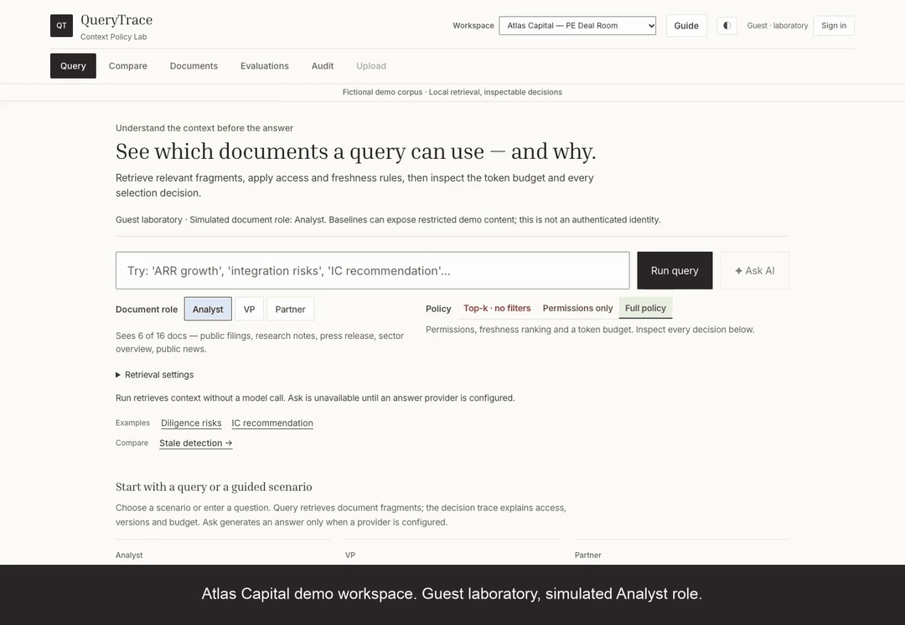

# MadeThis visual renewal

QueryTrace retains the application structure and behavior from
`codex/querytrace-improvements` at `3d155d2`. This work is isolated on
`codex/querytrace-madethis-style`; no push, merge, tunnel or deployment was made.
Implementation commit: `ecf13e5`. The following documentation commit contains
the captures, reports and regenerated demo.

## What changed

The light theme uses MadeThis's observed cream `#FCFBF7`, white surfaces,
charcoal `#2B2627`, body ink `#373532`, warm gray `#4D4841`, sand `#F2EFEB`
and fine warm dividers. Inria Serif regular replaces Fraunces for headings;
Inter replaces the system UI font. Buttons and panels have 1–2px radii, flat
reading surfaces, restrained overlay shadows and short color transitions.
The QueryTrace name and QT monogram remain, including a matching favicon.

Blue selection and green success surfaces reflect the reference's pastel tabs.
Blocked, warning and excluded states use accessible QueryTrace-specific colors
with their existing text labels. Input boundaries and immediate keyboard focus
are stronger than the reference's decorative lines. System monospace remains
for code, IDs and technical values. Font files and OFL notices are local; common
Latin fonts total about 63 KiB, with extended subsets loaded only when needed.

Dark mode is our adaptation of the same system: warm charcoal surfaces, cream
text and lighter semantic colors. No dark theme was observed on MadeThis.

The header order, workspace/session controls, Guide, navigation, query form,
roles, policies, summary/trace/results, Compare order and all secondary screens
retain their existing organization and responsive breakpoints. Compare keeps
three equal columns at 1440px; the pre-existing layout stacks at 1024px and below.
The desktop Guide stays above the application and does not narrow those columns.
The smaller-screen Guide retains its bottom position and scroll space.

No policy, corpus, fixture, threshold, query contract, backend behavior or tutorial
logic changed. The only app.js change renames a CSS color token in a progress bar.
CSS changes are integrated into the existing rules and token definitions.

## Reference and Taste

[Pre-edit mapping](design-mapping.md) · [Taste access limitation and setup](taste-access.md)

Taste was **not available**: no authenticated MCP or environment credential.
No extraction or external adherence check ran and no score is claimed. The
implementation uses live browser inspection of [MadeThis](https://www.madethis.com/),
its interior Agency tab and login focus state. Official Taste documentation was
reviewed. QueryTrace has no Taste runtime connection, account or key requirement.

Reference evidence: [home](reference/home.png), [active Agency tab](reference/agency-active.png),
[login focus](reference/login-focus.png), [computed styles](reference/computed-styles.json).
Only the visual system is translated; commercial content, logos, client media,
floating objects and the landing-page layout are not included in QueryTrace.

## Comparable captures

Before and after use the same production checkout on port 8025, before and after
CSS changes. PE workspace; guest laboratory Analyst; Full Policy; k=8;
2,048-token budget; question: **“What is Meridian's ARR growth rate and net revenue
retention?”**. Viewport height is 1,000px. Query-start images precede entry of the
question; login uses public accounts and Upload uses Patricia. Audit timestamps
and latency proxies naturally vary. No response or policy was altered for images.

All 80 states were checked in each sweep: 10 screens × four widths × two themes.
This directory retains 14 representative pairs; all states and overflow outcomes
are recorded in the [before matrix](before/matrix.json) and [after matrix](after/matrix.json).
Earlier evidence is preserved.

| Screen | Before | After |
|---|---|---|
| Query · 1440 light | [Before](before/query-1440-light.png) | [After](after/query-1440-light.png) |
| Query · 375 light | [Before](before/query-375-light.png) | [After](after/query-375-light.png) |
| Results · 1440 light | [Before](before/results-1440-light.png) | [After](after/results-1440-light.png) |
| Results · 375 dark | [Before](before/results-375-dark.png) | [After](after/results-375-dark.png) |
| Compare · 1440 light | [Before](before/compare-1440-light.png) | [After](after/compare-1440-light.png) |
| Compare · 768 dark | [Before](before/compare-768-dark.png) | [After](after/compare-768-dark.png) |
| Trace · 1024 light | [Before](before/trace-1024-light.png) | [After](after/trace-1024-light.png) |
| Documents · 1440 light | [Before](before/documents-1440-light.png) | [After](after/documents-1440-light.png) |
| Evaluations · 375 light | [Before](before/evals-375-light.png) | [After](after/evals-375-light.png) |
| Audit · 1024 dark | [Before](before/audit-1024-dark.png) | [After](after/audit-1024-dark.png) |
| Upload · 768 light | [Before](before/upload-768-light.png) | [After](after/upload-768-light.png) |
| Login · 375 dark | [Before](before/login-375-dark.png) | [After](after/login-375-dark.png) |
| Guide · 1440 light | [Before](before/guide-1440-light.png) | [After](after/guide-1440-light.png) |
| Guide · 375 dark | [Before](before/guide-375-dark.png) | [After](after/guide-375-dark.png) |

[Empty result with open trace](tests/empty-375-dark.png) is checked at every target
width in both themes, alongside zero-budget Query and Compare.

## Validation

Run commands from this checkout. Python 3.11 and Chromium were used locally.
The browser regression server uses temporary corpora and a deterministic answer
provider. The production server has Ask disabled. No paid model requests ran.

| Command / check | Result | Evidence |
|---|---|---|
| `python -m pytest tests/ -q` | 508 passed; one upstream Starlette/httpx deprecation warning | [Log](tests/pytest.txt) |
| `ruff check src/ tests/` | Passed | [Log](tests/ruff.txt) |
| `node --check frontend/app.js`; `git diff --check` | Passed | [Static checks](tests/static-checks.txt) |
| `QUERYTRACE_TEST_PYTHON="$PWD/.venv/bin/python" npm run test:e2e` | 50 passed, no skipped or weakened tests | [Log](tests/browser.log), [summary](tests/browser-summary.json) |
| `node tests/browser/ui-polish.cjs` | 80 before + 80 after; 375/768/1024/1440px, light/dark; no viewport overflow or console/page errors | [Matrix log](tests/matrix.log) |
| `node tests/browser/verify-style.cjs` | 8 theme/width cases; served HTML/CSS/JS/fonts match checkout; loaded local fonts; OS themes; keyboard focus; hover; disabled Ask; empty traces; workspace reset; desktop Guide/Compare geometry; zero external runtime requests | [Report](tests/style-checks.json), [log](tests/style-checks.log) |
| `node tests/browser/accessibility-surfaces.cjs` | 12 axe WCAG A/AA scans, zero violations, plus 4 Query/Guide scans in the regression suite | [Report](tests/additional-accessibility.json), [Query/Guide](tests/query-guide-accessibility.json), [log](tests/accessibility.log) |
| `node tests/browser/production-smoke.cjs` | Both real corpora; Query, Compare, Documents, Evaluations and Guide; no test routes or model calls | [Report](tests/production-smoke.json), [log](tests/production-smoke.log) |
| Local Markdown file links | No missing file targets | [Report](tests/documentation-links.json) |
| H.264 decode and full-speed playback | Entire export reviewed at eight checkpoints; no playback or decode errors; GIF decodes to 470 frames | [Playback](video/playback-review.json), [visual review](video/manual-review.json), [log](tests/playback.log) |

Regression coverage includes six account logins, reload/logout on both local
hostnames, authenticated vs simulated roles, workspace changes, actual upload,
empty/restricted corpora, absent/failed evaluations, permission and token-budget
outcomes, simulated Ask's actual sent context, safe Markdown and exports. Guide
coverage retains results from an empty start, restores prior drafts, runs Compare
and opens Full Policy's trace.

For the non-mutating production checks, prefix commands with:

```sh
QUERYTRACE_SMOKE_BASE_URL=http://localhost:8025 \
QUERYTRACE_SMOKE_OUTPUT_DIR=docs/evidence/madethis-style/tests
```

Use a separate output directory for the full screenshot sweep if only selected
pairs should be committed. `QUERYTRACE_TEST_OUTPUT_DIR` similarly redirects the
regression suite's larger evidence set. Historical evidence directories are not
used as outputs for this revision.

## Demo and review instance

[](video/querytrace-demo.mp4)

[MP4](video/querytrace-demo.mp4) · [Local player](video/index.html) · [Captions](video/captions.srt)
· [Recording evidence](video/demo-run.json) · [Regeneration instructions](../../demo-guide.md#regenerate-the-recording)

The 59-second recording performs real query, source expansion, trace inspection,
policy comparison and Guide reopening. Captions derive counts from API responses.
The README retains its animated GIF preview and original YouTube destination;
the linked local MP4 and GIF reflect this visual revision. The earlier YouTube
video was not replaced or uploaded again.

Review the application at [localhost:8025/app/](http://localhost:8025/app/).
The server is bound to loopback and runs this isolated worktree.

[Final served-file identity check](tests/served-checkout.json) confirms the
HTML, CSS, JavaScript, favicon and four fonts match this checkout; the recording
uses the same CSS hash. Startup:

```sh
env -u ANTHROPIC_API_KEY .venv/bin/python -m uvicorn src.main:app \
  --host 127.0.0.1 --port 8025
```

## Boundaries

Taste extraction and external similarity scoring remain unavailable. Docker,
remote CI, deployment, Firefox/WebKit and manual assistive-technology testing
were not rerun or claimed. Historical Linux Docker evidence remains available.
The font subsets fall back to system fonts for unsupported scripts. Retrieval,
benchmark and optional provider limitations remain those documented in the main
README. No external publication occurred.
